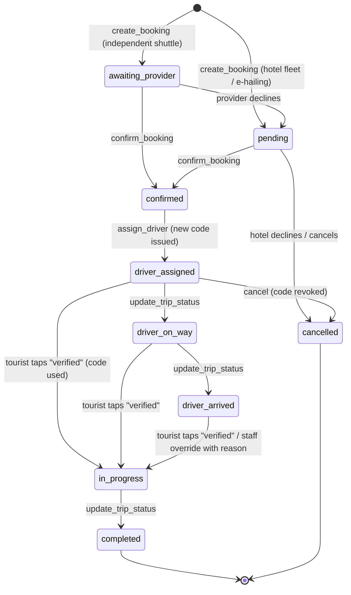
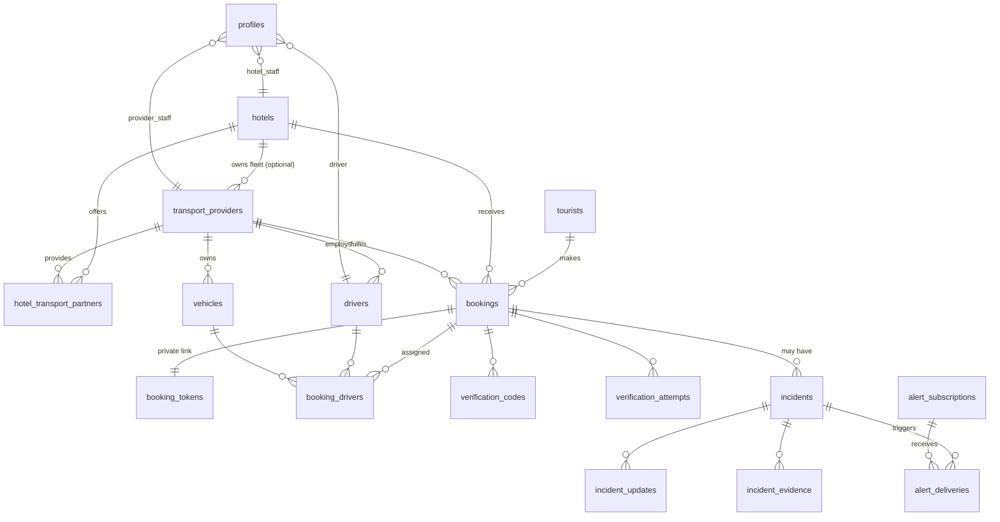
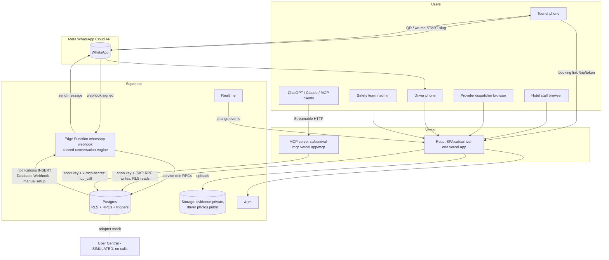
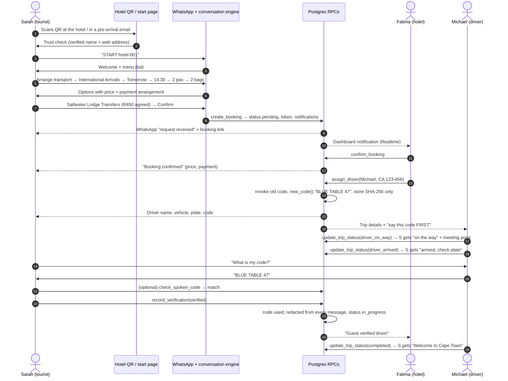
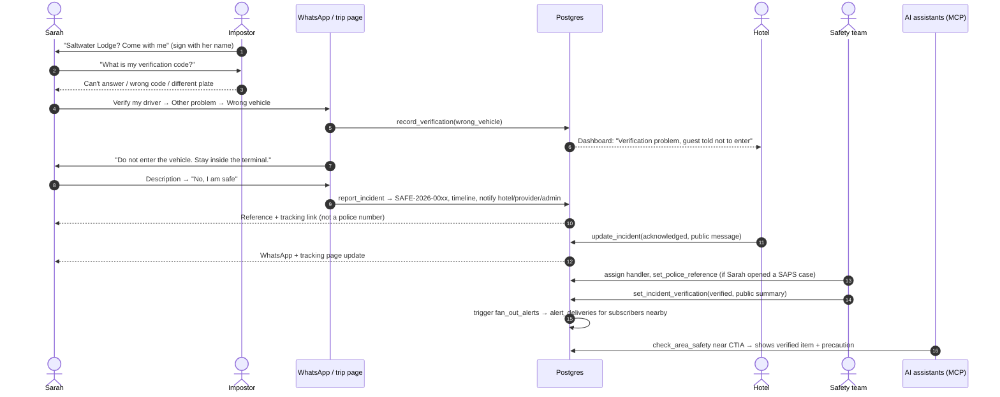
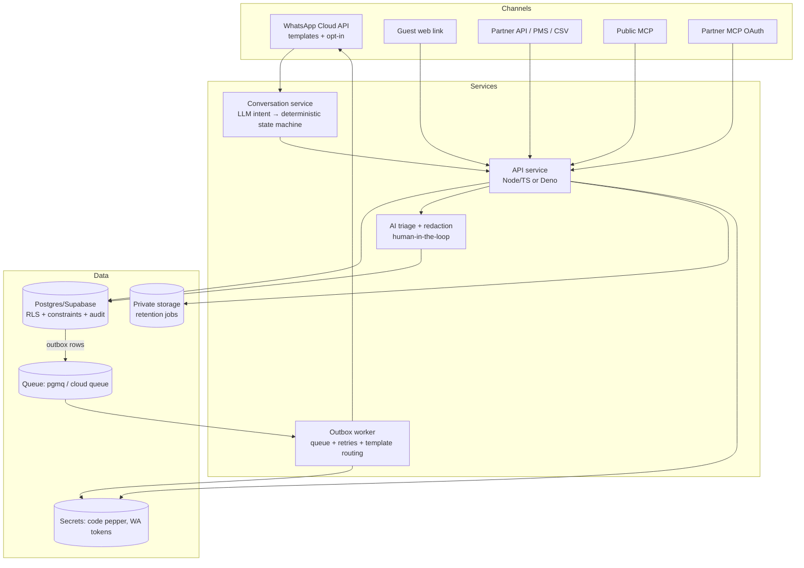

# SafeArrival V2: technical and product handover report

**Repository:** `kavierjogie/safe-arrivalV2` (branch `main`, commit `5632923`)
**Prepared:** 25 November 2026
**Method:** I read every source file, all 10 SQL migrations, the Edge Function, the MCP server, the tests and the docs. I ran the automated tests (all 5 suites pass) and checked the two live endpoints (`safearrival-one.vercel.app` returns 200; `safearrival-mcp.vercel.app/health` reports the database as reachable). I did **not** test against a real Meta WhatsApp account, real Uber APIs or the live Supabase dashboard settings (Database Webhooks, Auth settings), because none of these are in the repository. Where I say "documented but not implemented", the claim comes from reading the code.

**How to read the labels in this report**

| Label | Meaning |
|---|---|
| **Implemented** | The code exists, runs, and the tests cover it. |
| **Implemented, untested live** | The code exists but has never run against the real external service. |
| **Simulated** | The UI behaves as if the feature works, but nothing real happens (for example, no API call leaves the system). |
| **Partial** | Some of it exists; important parts are missing. |
| **Planned / documented only** | Mentioned in docs, schema or UI copy, with no working code. |

---

## 1. Executive summary

SafeArrival V2 ("Safe Arrival CPT") is a hackathon prototype for the Cape Town Tourism *Safer and Smarter Tourism* hackathon. The whole history is 10 commits made on 24 November 2026, about 9,800 lines in total. It does two things:

1. **Trusted pickup coordination.** A tourist books an airport transfer through their hotel (on WhatsApp or a web form). The hotel or shuttle company assigns an approved driver. The system then sends the tourist and the driver the same one-time spoken code, such as `BLUE TABLE 47`. At the kerb the **driver must say the code first**. If the driver can't, the tourist refuses the ride and reports it, and the hotel, the provider and a central safety team are alerted.
2. **Safety intelligence for AI assistants.** A public MCP server (11 tools) lets ChatGPT, Claude and other MCP clients look up transport-safety reports near a place or route, check whether a transport company is a partner, check a driver against a booking, get pickup guidance and emergency numbers, file a report, and subscribe to alerts about incidents the safety team has verified.

**What is real:** a carefully designed Postgres backend on Supabase. It has Row Level Security on every table, every write goes through a role-checked function ("RPC"), and it keeps an audit log. On top of it sit a React dashboard for five roles, a WhatsApp conversation engine shared between a browser simulator and a production webhook, and a working, deployed MCP server. The engineering quality is well above typical hackathon code: the tests run the real SQL, and the privacy thinking is good (verification labels, no raw text to AI clients, no "safety scores").

**What is not real:** all data is fictional. WhatsApp has never been connected to a live Meta account. Uber Central is a mock. No email is ever sent. There is no GPS or live trip tracking. "Driver vetting" is an admin setting a status, with no documents checked. No AI or LLM is used anywhere in the product, despite the "AI integrations" admin page. The "AI" is the external assistants that call the MCP server.

**The biggest problems (detail in sections 11 and 16):**

1. **WhatsApp delivery will mostly fail in production.** Driver messages, and most tourist messages after booking, are sent outside WhatsApp's 24-hour customer-service window. Meta only accepts pre-approved *templates* there, and none exist for bookings.
2. **The live demo makes every visitor an admin.** The public site shows the demo password and a one-click "Admin" button, on the same database the public MCP server reads. Anyone can publish a "verified" incident that Claude and ChatGPT users will then see, and that triggers alerts to real subscribers.
3. **The verification-code space is only 23,040 codes and can never be reused.** After about 23,000 driver assignments in total, the system can no longer issue codes, so assigning a driver fails. The codes are also hashed without a secret, so a database leak reveals them instantly.
4. **"Verified" means the tourist tapped a button.** The server does not require the spoken code to match before it starts the ride.
5. **No commercial integration exists**, and the hardest part of the business (real hotels, real shuttles, real driver vetting, Uber API access) is entirely untouched.

**My overall view:** the *verification protocol* ("the driver proves who they are by saying a secret you received through a trusted channel") and the *safety-data publishing discipline* (verified vs unverified, approximate locations, no scores, prompt-injection-safe output) are the genuinely valuable ideas. The *booking marketplace* around them is the least defensible part: it needs operations, partnerships and liability, while hotels and transfer companies already have booking tools. Section 18 explores this and recommends a narrower product: a **pickup-verification layer for hotels and transfer operators**, plus a **verified tourist-safety knowledge service** delivered over WhatsApp and MCP.

---

## 2. Original problem statement

### 2.1 The problem
A tourist landing at Cape Town International Airport (CTIA) is tired and unfamiliar with the place. Often they are also roaming without data, carrying luggage and cash, and don't know what transport should cost. At that moment they are approached by people offering rides. The failure modes the code is designed around (they are the incident categories in `incidents.category`) are:

| Category in code | Real-world scenario |
|---|---|
| `suspected_scam` | Touts inside the terminal offering a "hotel shuttle" or "official taxi" for cash |
| `driver_mismatch` / `vehicle_mismatch` | Someone holds a sign with the tourist's name (easy to copy) but is not the booked driver |
| `extra_payment` | An unexpected cash "airport fee" or surcharge on top of an agreed price |
| `code_incorrect` | The person claiming to be the driver cannot prove it |
| `intimidation` | Pressure, threats, refusing to unload luggage until paid |
| `cannot_locate_driver` | The booked driver isn't at the pickup point, which creates the opening for touts |

### 2.2 Why arriving tourists are especially vulnerable
- **Information asymmetry.** They don't know the legitimate pickup zones, prices or operators.
- **Identity is weak.** A name on a sign or a hotel logo on a WhatsApp profile is trivial to fake. Booking confirmations often include the driver's name, and impostors can learn the tourist's name.
- **Timing.** Jet lag, roaming without data, and pressure to leave the terminal quickly.
- **Fragmented responsibility.** The hotel books, a third-party shuttle drives, the airport manages the kerb, and the police handle crime. Nobody owns "did the right person pick up the right guest?".
- **Reporting goes nowhere.** A tourist who is overcharged rarely files a police case before flying home, so patterns never surface.

*(I can't cite statistics from the repository. All incident data in it is fictional, so treat any claimed scale of the problem as unvalidated. This report does not estimate the size of the problem.)*

### 2.3 What the existing industry solves, and what it doesn't
| Existing option | What it solves | What it leaves open |
|---|---|---|
| **Uber / Bolt** | Driver identity in the app (name, photo, plate), GPS tracking, cashless payment, trip sharing. Uber also offers PIN verification in some markets. | Only for app-booked rides. No link to the hotel. A tourist without data or the app is excluded. Doesn't cover hotel or shuttle transfers. |
| **Hotel transfers / shuttle companies** | A pre-arranged, pre-paid ride with a known operator | Identity proof is usually "a sign with your name". Driver details arrive late or by email. There is no standard way to report a problem across operators. |
| **Airport official ranks / signage** | Legitimate pickup zones | Doesn't stop touts inside the terminal, and doesn't verify a specific driver |
| **Police / SAPS** | Criminal cases | Not designed for near-misses, overcharging or patterns. Tourists rarely report. |

### 2.4 How SafeArrival differs
SafeArrival is **not a ride-hailing app**: it has no driver supply, no dispatch, no pricing engine and no payments. It is a **coordination and verification layer** that sits above any provider (hotel fleet, shuttle, e-hailing) and gives every pickup the same three guarantees, which are the product tagline:

> *Know who is picking you up, know what you should pay, and know who to contact if something goes wrong.*

The distinctive mechanism is **reverse verification**. The tourist never reveals anything. The driver has to prove knowledge of a secret that only the real driver received, so the burden of proof sits with the driver. A provider-neutral incident pipeline then feeds a safety-intelligence layer, which is published (with verification labels) to AI assistants.

### 2.5 Value by stakeholder (as the code intends it)
| Stakeholder | Value |
|---|---|
| Tourist | Driver identity + code before arrival; a price agreed in writing; a one-tap "Something's wrong"; status updates; emergency numbers; no app install (WhatsApp) |
| Hotel | Fewer guest-safety failures, a single dashboard for guest transfers, a record of incidents, a QR poster for onboarding, control over which providers and prices guests see |
| Transport provider | Receives bookings from partner hotels, protected from impostors using their name, a documented "approved partner" status |
| Driver | A clear trip list and a way to prove legitimacy. Can't be blamed for a ride started without verification. |
| Safety team / city / tourism body | Cross-provider incident data, pattern detection, verified public advisories, a channel into AI assistants |

---

## 3. Product vision and objectives

**Vision (from the code and README):** every tourist pickup in Cape Town is verifiable, priced in advance and reportable, whoever the transport provider is. Safety knowledge reaches tourists wherever they already are: WhatsApp, and AI assistants such as ChatGPT and Claude.

**Objectives built into the design:**
1. One verification process across all providers (the same code, rules and screens).
2. WhatsApp-first: no app download, no account for tourists (they hold a private link token instead).
3. Price transparency: agreed price, estimate range or "on request", plus the payment arrangement, always shown before confirmation.
4. Safe-by-default communication: "the driver says the code first", "a sign with your name is not proof".
5. Honest safety data: verified vs unverified labels, no "safe/dangerous" verdicts, approximate locations.
6. Defence in depth: the database enforces the rules even if the UI is bypassed.

---

## 4. Target users and stakeholders

| Role (in `profiles.role`) | Who | How they sign in | Main screens |
|---|---|---|---|
| Tourist (no role, anonymous) | Arriving visitor | No login. Holds a 144-bit random token in a link (`/trip/<token>`). An optional Supabase account lists their bookings. | `/start`, `/assistant`, `/book`, `/trip/:token`, `/report`, `/incident/:token`, `/my-bookings`, `/alerts/:token` |
| `hotel_staff` | Front desk / concierge | Supabase email + password | `/hotel/*` |
| `provider_staff` | Shuttle dispatcher | Same | `/provider/*` |
| `driver` | Driver | Same | `/driver` |
| `admin` | SafeArrival safety team | Same | `/admin/*` |
| AI assistant users | Anyone using ChatGPT/Claude with the connector | None (the MCP server is public) | 11 MCP tools |
| Developers | Integrators | None | `/developers` |

**External stakeholders not modelled in code:** the airport operator (ACSA), SAPS, Cape Town Tourism, insurers, payment providers, e-hailing companies.

**Role assignment:** a new Supabase sign-up always becomes `tourist` (trigger `handle_new_user`). Staff roles can only be set by editing `profiles` directly in the database. There is **no invite or onboarding flow** for hotel staff, provider staff or drivers. It is done in SQL.

---

## 5. Complete feature breakdown

### 5.1 Tourist experience

#### QR onboarding (`/start`, `/s/:code`): **Implemented**
- **What:** A hotel prints a QR poster (generated at `/hotel/setup` with `qrcode.react`, downloadable as a PNG or printable). Scanning it opens `/s/<short_code>`, which redirects to `/start?hotel=<slug>`. With `VITE_WHATSAPP_NUMBER` set, the button opens `wa.me/<number>?text=START hotel-001`.
- **Interaction:** The page first teaches a **trust check**: confirm the WhatsApp business name has the verified badge, and confirm the page address. Only then are the tourist's details asked for. This is a thoughtful touch that defends against fake QR stickers.
- **Behind the scenes:** a lookup in the `hotels` table (anonymous users can read active hotels through RLS). On real WhatsApp, the webhook parses `START <slug>` and stores the hotel in the session context with `source = 'qr_hotel'`.
- **Gaps:** the "verified badge" assumes SafeArrival has Meta's verified business status, which it doesn't have. The airport QR (`src=airport`) just leads to a hotel picker.

#### WhatsApp assistant: **Simulated on the web; production webhook implemented, untested live**
- **What:** A menu-driven chat with 20 states (`supabase/functions/_shared/conversation.js`, 292 lines): welcome → menu → hotel → pickup point → day/date → time → passengers → luggage → name → phone → transport option → confirm → booked → verification → incident flow.
- **Interaction:** WhatsApp interactive lists (up to 10 rows) and reply buttons (up to 3), plus typed text for dates, times, names and phone numbers. Global keywords: `hi/menu/start/restart`, `emergency/sos/police/danger` (emergency numbers), `human/agent/staff` (hotel phone).
- **Behind the scenes:** `handle(session, input, api)` is a pure function with no imports, so the same file runs in the browser (`/assistant`, through `simulatorApi`, which calls the RPCs) and in Deno (the Edge Function, using the service-role client). Conversation state lives in `whatsapp_sessions` (production) or `localStorage` (simulator). In the simulator, backend "WhatsApp" messages from the `notifications` table are merged into the chat by polling `get_trip`.
- **Tables / RPCs:** `whatsapp_sessions`, `create_booking`, `get_trip`, `record_verification`, `check_spoken_code`, `report_incident`.
- **Limitations:** no natural-language understanding (regex and menu IDs only); English only; at most 10 hotels and 10 pickup points (a WhatsApp list limit, with no paging); dates are parsed as day/month only. The `human/agent` keyword promises "our safety team will follow up", but nothing routes the conversation to a human. There is no inbox or handover.

#### Booking (`/book` web form, and in chat): **Implemented**
- **What:** Choose a hotel, a pickup point, the arrival date and time, an optional flight number, passengers, bags, and one of the hotel's transport options. The form shows the price type (agreed / estimate / on request), capacity and payment arrangement.
- **Behind the scenes:** `create_booking(p jsonb)` validates the name, the E.164 number, a time window (from 6 hours ago to 365 days ahead), the flight-number format, that the hotel and provider are active, that the option belongs to the hotel, and capacity. It upserts the `tourists` row by WhatsApp number and enforces **5 bookings per number per hour**. A booking on an independent shuttle starts as `awaiting_provider`, otherwise `pending`. It creates a `booking_tokens` row (a random 18-byte token) and queues a tourist WhatsApp message plus hotel and provider dashboard notifications.
- **Reference format:** `CT-TRIP-2026-001` (the sequence is reset by the demo reset).
- **Gaps:** the WhatsApp number is **not verified** on the web form (no OTP), so anyone can book in a victim's name and number. No check that the tourist actually has a reservation at the hotel. Flight numbers are stored but no flight-status API is used.

#### Trip page (`/trip/:token`): **Implemented**
- A status stepper, a driver card (name, photo, make, model, colour, registration), and a **code card** (the plaintext code, expiry, and the rule "driver says it FIRST"). Also a typed-code check, five verification outcomes, a Leaflet/OSM map with a "Get directions" Google Maps link, price, contacts, the WhatsApp message history, and cancel.
- The driver's phone number is shown only once the driver is `driver_on_way` or `driver_arrived`.
- **Data:** a single RPC, `get_trip(token)`, returns everything. It polls every 4 s on Supabase, because anonymous users can't receive RLS-filtered Realtime events.

#### Driver verification at pickup: **Implemented (see the security caveats in section 11)**
- **Flow:** the driver arrives → the tourist asks "What is my code?" → optionally types what the driver said (`check_spoken_code`, which compares hashes, allows 5 checks per 10 minutes, and does not use up the code) → taps one of: `verified`, `code_mismatch`, `details_mismatch`, `wrong_vehicle`, `cannot_find` (`record_verification`, max 10 per 10 minutes).
- `verified` marks the code `used`, deletes it from all message history, sets the booking to `in_progress`, and notifies the hotel. Any failure notifies the hotel and provider dashboards, and the UI goes straight to a pre-filled report.
- **Rules enforced by the database:** a driver **cannot** move a booking to `in_progress` himself. Hotel or provider staff can do so only with a written reason (5 characters or more), and the override is audited (`start_without_verification`).

#### "Something's wrong" reporting (`/report`, and in chat): **Implemented**
- 8 categories, a description (max 2,000 characters), a location, an urgent flag, and up to 3 photos (compressed in the browser to 1280px JPEG, uploaded to the private `incident-evidence` bucket). It returns an internal reference `SAFE-2026-0001` at once, and the UI states explicitly that **this is not a police case number**.
- `report_incident` adds automatic timeline updates (received → provider notified → hotel notified → hotel pending) and notifies hotel, provider and admin dashboards, plus the tourist on WhatsApp. If the report is urgent, emergency numbers are shown first.
- A booking isn't required: anonymous reports can name a hotel slug or a pickup point.
- `/incident/:token` is a live public timeline showing public updates only, with an explanation of each status in plain English.

#### My bookings (`/my-bookings`): **Implemented**
Links are remembered in `localStorage` (on this device only). A signed-in tourist can also call `my_trip_links()`.

#### Safety alerts (`/alerts/:token`): **Implemented (web); WhatsApp channel implemented, untested live**
This is a self-service page for a subscription created through MCP: view alerts, pause, resume, change radius or categories, extend, unsubscribe. Unsubscribing **erases the phone number and location**.

### 5.2 Hotel experience (`/hotel/*`): **Implemented**
| Feature | Details | RPC |
|---|---|---|
| Overview | Stats, live notifications, upcoming arrivals | reads only |
| Bookings | Filter, open a drawer, confirm (optionally setting a price; `on_request` needs one), decline (cancels the booking for the guest), change the provider option, set the price, assign driver + vehicle, update status, cancel | `confirm_booking`, `decline_booking`, `change_booking_option`, `set_booking_price`, `assign_driver`, `update_trip_status`, `cancel_booking` |
| Drivers | Own-fleet drivers and vehicles (new drivers start as `pending`) | `add_driver`, `add_vehicle` |
| Incidents | Acknowledge, update status, public or internal notes, record a SAPS case number supplied by the tourist | `update_incident`, `set_police_reference` |
| Setup | QR poster, short link, email link text, editor for transport options and prices | `save_partner_option` |

The assignment drawer only offers **approved** drivers and **active** vehicles of the booking's provider. The database checks this again, along with seat count vs passengers. **Staff never see the code.** `assign_driver` returns only its expiry time.

### 5.3 Transport provider experience (`/provider/*`): **Implemented**
Bookings from partner hotels (accept, decline, assign; when a provider declines, the booking goes back to the hotel instead of cancelling the guest), fleet management, incident alerts, profile. The provider dashboard uses the same `BookingDrawer` with the adapter from `services/transport/adapters.js`.

### 5.4 Driver experience (`/driver`): **Implemented**
Assigned trips only (RLS through `booking_drivers.active`). The code is shown only from the driver's own WhatsApp message. Buttons: *I'm on my way* → *I've arrived* → *Completed*. The driver **cannot start** the ride. The RPC returns "the guest must verify you first".

### 5.5 Administrator / safety team (`/admin/*`): **Implemented**
| Page | What it does |
|---|---|
| Overview | Platform KPIs; **safety-intelligence patterns** (`lib/intelligence.js`): 3 or more reports of the same category at the same pickup point within 30 days; 2 or more of the same category for one provider; 3 or more verification failures at one point. All computed in the browser. Wording such as "complaints … were reported" deliberately avoids claiming a crime. |
| Incidents | Investigate, assign a handler (admins only), status, public/internal updates, SAPS reference, **public safety intelligence**: write a public summary and publish as `verified` / `official_advisory` / `rejected` (`set_incident_verification`). Publishing fires alert subscriptions. |
| Partners | Approve, suspend or reject hotels, providers and drivers (`set_partner_status`) |
| Analytics | Recharts: incidents by type, location and provider, over time, verification failures, payment complaints. Computed in the browser from up to 2,000 rows per table. |
| AI integrations (`/admin/ai`) | MCP usage (calls per tool or client, errors, rate limits, latency, ~10 km usage areas), reports from AI, subscription and delivery counts, **dataset switches** (turn off e.g. `incident_reports` for AI clients instantly, audited), server health |
| Audit | `audit_logs` viewer |

### 5.6 Pricing: **Implemented (static)**
Each `hotel_transport_partners` row has a `price_type`: `agreed` (a fixed amount), `estimate` (min–max), or `on_request` (the hotel must set a price before confirming). Hotels can override the price per booking (between R1 and R20,000). Every message carries a sentence about the price ("you should not be asked to pay the driver anything extra"). **No payments are processed** and no fares are calculated. The Uber "estimates" are hard-coded ranges in the seed data.

### 5.7 Notifications: **Partial**
| Channel | Status |
|---|---|
| Dashboard (staff) | **Implemented.** `notifications` rows + Supabase Realtime + toasts |
| WhatsApp (tourist/driver) | **Implemented, untested live, and structurally broken** for messages outside the 24-hour window (section 11.6). In demo mode rows stay `delivery_status = 'simulated'` and appear in the simulator and trip page. |
| WhatsApp safety alerts | Template-based dispatcher implemented, untested live. Off by default (`whatsapp_alerts_enabled = false`). |
| Email | **Not implemented.** The schema allows `channel = 'email'`, but nothing writes or sends email. |
| SMS / push / web push | Not implemented ("web push can read the same rows later" is a comment) |

### 5.8 Trip tracking: **Status-only; no location tracking**
"Tracking" means the booking status changes when the driver taps buttons. There is **no GPS**, no live map of the driver, no ETA and no geofence. The map shows only the fixed pickup point.

### 5.9 Safety intelligence and MCP: **Implemented (fictional data)**
11 tools, detailed in section 9.3. All logic lives in SQL (`private.tool_*`). Output rules: raw descriptions never leave the database; verified items show an admin-written `public_summary`, unverified ones show a templated category phrase; locations are a pickup point or rounded to about 1 km; every result carries `limitations` and a `DEMO DATA` notice.

### 5.10 Developer portal (`/developers`) and Agent Skill (`skills/`): **Implemented**
A live tool reference (`tools/list` fetched from the MCP server), a try-it console, connection guides for Claude, ChatGPT, Cursor and VS Code, and an Agent Skill (`SKILL.md`) teaching assistants how to use the tools safely. `mcp-server/test/docs.test.mjs` fails if the docs and the tools disagree.

### 5.11 Internationalisation: **Planned**
`i18n/` has an English dictionary (15 lines) used by 2 components. `fr/de/es/zh` are listed as "prepared" but **no translations exist**. The conversation engine and every SQL message are hard-coded in English.

### 5.12 Feature dependency map

```mermaid
flowchart LR
  partners[Partner hotels / providers approved] --> options[Transport options + prices]
  drivers[Driver + vehicle approved] --> assign
  options --> booking[Booking]
  booking --> confirm[Hotel/provider confirms]
  confirm --> assign[Assign driver]
  assign --> code[One-time code issued]
  code --> wa[WhatsApp delivery to tourist + driver]
  wa --> verify[Kerb verification]
  verify -->|fail| incident[Incident report]
  incident --> review[Safety team review]
  review -->|publish verified| intel[Public safety intelligence]
  intel --> mcp[MCP tools]
  intel --> alerts[Alert fan-out]
  alerts --> wa2[WhatsApp template / web feed]
```

**The critical dependency:** the whole verification promise depends on **reliable WhatsApp delivery of the code to the driver**. That is the single weakest link in production (section 11.6).

---

## 6. Frontend architecture

| Aspect | Implementation | Why it was probably chosen |
|---|---|---|
| Framework | React 19 SPA, plain JavaScript (no TypeScript), React Router 7 | Speed of hackathon development |
| Build | Vite 8, Tailwind CSS v4 via `@tailwindcss/vite`, oxlint | Fast builds, zero-config CSS |
| Code splitting | Every page except landing and 404 is `lazy()`-loaded | Keeps the tourist path light on mobile |
| State | `AppContext` (session, profile, `act()` helper); `useLive(load, deps, {poll})` re-runs loaders on any data change; `useTables([...])` loads several RLS-filtered tables at once | Lets dashboards stay "live" without a state library |
| Data access | `services/api.js`: `rpc()` for all writes, `select()` / `selectMany()` for reads. **One client, two backends**: Supabase, or PGlite in the browser. | Lets the demo run with no backend at all |
| Live updates | Supabase Realtime `postgres_changes` on the whole `public` schema (debounced 150 ms) → every live view refetches. Demo mode uses `BroadcastChannel` across tabs. Anonymous tourist pages poll every 4 s. | Simple, but sends every change to every dashboard (scalability, section 16) |
| Auth guard | `RequireRole` wrapper per route group; RLS enforces the same rules server-side | Defence in depth |
| Maps | Leaflet + OpenStreetMap tiles, one `CircleMarker` for the pickup point, a Google Maps directions link | No API key needed |
| Charts | Recharts | |
| UI | Custom components (`components/common/ui.jsx`), Lucide icons, Sonner toasts | |
| Presenter bar | A floating bar on **every page**: switch role with one click, guided demo script, shortcuts ("Hotel: confirm + assign Michael"), reset | Built for judging, but it ships to the live site (risk, section 11.1) |
| Device memory | `localStorage` for trip/report links and the simulated chat; `sessionStorage` for the per-tab demo role | Tourists need no account |

**Route map:** public (`/`, `/how-it-works`, `/safety`, `/start`, `/s/:code`, `/login`, `/developers/:section?`), tourist (`/assistant`, `/book`, `/trip/:token`, `/report`, `/incident/:token`, `/alerts/:token`, `/my-bookings`), hotel (5 routes), provider (4), driver (1), admin (6).

### 6.1 PGlite demo mode: what it is and why it exists
PGlite is PostgreSQL compiled to WebAssembly. `src/lib/localdb/` boots it in a Web Worker shared across tabs (leader election), persisted to IndexedDB. Then it runs a small **Supabase stand-in** (`bootstrap.sql`: the `anon`/`authenticated` roles, `auth.users`, `auth.uid()`, pgcrypto), followed by **all 10 real migrations** and the real `seed.sql`. Each query runs inside a transaction that sets `request.jwt.claims` and `SET LOCAL ROLE`, exactly as Supabase's REST layer (PostgREST) does, so **RLS really is enforced in the browser demo**. The database name is a hash of the SQL, so a schema change gives a fresh database.

**Why:** judges can run the full product with `npm run dev` and no accounts, and the same machinery powers the Node test suites. **Cost:** a second runtime to maintain (worker leadership hand-over, timeouts and retries in `localdb/index.js`), a large WASM download in demo mode, and code paths that differ between modes (realtime vs BroadcastChannel, data URLs vs Storage for photos, demo sign-in without a password).

### 6.2 Demo mode vs production mode
| | Demo mode (no `VITE_SUPABASE_*`) | Supabase mode (the live site) |
|---|---|---|
| Database | PGlite in the browser, per device | Shared Supabase Postgres (eu-central-1) |
| Auth | Pick a demo account, no password, per tab | Supabase email/password; **the demo password is printed on the login page** |
| Live updates | BroadcastChannel between tabs | Realtime for staff; 4 s polling for tourists |
| Photos | Data URLs stored in the row | Storage buckets (`incident-evidence` private, `driver-photos` public) |
| WhatsApp | Simulator only | Simulator, unless `VITE_WHATSAPP_NUMBER` is set (and the webhook is deployed) |
| Reset | Local | `reset_demo()` wipes **everyone's** data (admin only, `demo_mode = true` only) |

---

## 7. Backend architecture

There is **no custom application server**. The backend is:

1. **Postgres on Supabase**, which holds almost all business logic as PL/pgSQL functions (about 1,800 lines across migrations 3, 6 and 7).
2. **One Supabase Edge Function** (`whatsapp-webhook`, Deno) for Meta's webhook and for outbound dispatch.
3. **One Node service** (the MCP server on Vercel), which is a thin translator to a single database function.

### 7.1 The "RPC-only writes" model
- `anon` and `authenticated` have `SELECT` on public tables (filtered by RLS) and **no INSERT, UPDATE or DELETE anywhere** (migration 2).
- Every change is a `SECURITY DEFINER` function in `public` that:
  1. identifies the caller (`app.role()`, `app.my_hotel()`, …, based on `auth.uid()`), or checks a token;
  2. validates the input and the allowed status transition;
  3. writes the change, notifications and an audit row in the same transaction.
- Helpers live in schema `private`, and `EXECUTE` on them is revoked from every client role.
- Migration 10 also revokes anonymous `EXECUTE` on staff RPCs, so a bug in a role check can only be reached by a signed-in user.

**Why this design:** with Supabase, the browser talks almost directly to the database. RPC-only writes plus RLS make the database the security boundary, and the tests can check it end to end. **Trade-off:** business logic in SQL is harder to version, debug, observe and extend (no logging, no retries, no outbound HTTP), and it mixes message wording (English text) into SQL.

### 7.2 Booking state machine (enforced in SQL)

Reassigning a driver revokes the old code and issues a new one.

### 7.3 Incident lifecycle
`received → hotel_notified → hotel_pending / provider_notified → escalated → referred_authorities → follow_up → resolved → closed` (only an admin can close). A separate field, `verification_status` (`unverified / verified / official_advisory / rejected`), controls what the public and AI clients see.

### 7.4 Alert fan-out (migration 7)
A trigger on `incidents` (`fan_out_alerts`) fires only when an incident **changes to** verified or advisory, provided the verification happened in the last 10 minutes, the incident is under 30 days old and has a location. It inserts one `alert_deliveries` row per matching active subscription (distance ≤ radius, category filter), with a uniqueness rule that prevents duplicate alerts. Web subscribers see the row on their manage page. WhatsApp rows are `queued` (or `not_configured`) for the dispatcher.

---

## 8. Database and data model

### 8.1 Tables (26 in `public`, 2 in `private`)
| Group | Tables | Notes |
|---|---|---|
| Directory | `pickup_points` (text id), `hotels`, `transport_providers`, `provider_service_areas`, `hotel_transport_partners` | Partners have `pending/active/suspended`; a provider's `integration` is `manual` or `uber_central` |
| Fleet | `drivers` (`pending/approved/rejected/suspended`, `photo_path`, `phone`), `vehicles` (unique registration) | No document, licence or permit fields |
| People | `profiles` (role + FK to hotel/provider/driver, with CHECK constraints), `tourists` (unique E.164 WhatsApp) | |
| Bookings | `bookings`, `booking_tokens` (kept **separate** so staff can never read tourist tokens), `booking_drivers` (one active per booking, enforced by a partial unique index) | |
| Verification | `verification_codes` (`code_hash` unique **for all time**; one active per booking), `verification_attempts` | No RLS policy at all on codes |
| Incidents | `incidents` (+ verification, public summary, approximate lat/lng, source), `incident_updates` (public/internal), `incident_evidence` | |
| Messaging | `notifications` (the outbox and the dashboard feed), `whatsapp_sessions` | |
| MCP | `emergency_contacts`, `safety_advice`, `mcp_requests` (no arguments, no IPs), `alert_subscriptions` (no client access), `alert_deliveries` | |
| Ops | `app_settings` (`demo_mode`, `code_ttl_minutes`, `mcp_datasets`, `mcp_coverage`, `public_app_url`, `whatsapp_alerts_enabled`), `audit_logs` | |
| `private` | `mcp_config` (the hash of the server secret), `mcp_rate` (rate-limit counters) | |

### 8.2 Row Level Security summary
| Table | Who can read |
|---|---|
| `pickup_points`, `provider_service_areas`, `emergency_contacts`, `safety_advice` | Everyone |
| `hotels`, `transport_providers` | Active ones publicly; own/all for staff/admin |
| `hotel_transport_partners` | Available ones publicly |
| `drivers` | Admin, own provider, the driver themself, partner hotels (approved drivers only, or the hotel's own fleet). **Never public.** |
| `bookings`, `booking_drivers`, `verification_attempts` | `app.can_see_booking`: admin, the booking's hotel, the booking's provider, the assigned driver, or a signed-in tourist who owns it |
| `incidents` | Admin, the incident's hotel or provider, the owning signed-in tourist. Evidence: staff only. Internal updates: staff only. |
| `notifications` | Only the matching recipient (hotel, provider, driver, admin). **Tourist and driver WhatsApp rows (which carry codes) can't be read by staff or admins.** |
| `booking_tokens`, `verification_codes`, `whatsapp_sessions`, `alert_subscriptions` | Nobody (SELECT revoked; access only through functions) |
| `audit_logs`, `mcp_requests`, `alert_deliveries`, `app_settings` | Admin |

### 8.3 Database functions (public RPCs)
- **Tourist (token-based, anonymous):** `create_booking`, `get_trip`, `record_verification`, `check_spoken_code`, `cancel_my_booking`, `report_incident`, `get_incident`, `get_alert_subscription`, `update_alert_subscription`, `unsubscribe_alerts`, `my_trip_links` (signed in).
- **Staff:** `confirm_booking`, `decline_booking`, `change_booking_option`, `set_booking_price`, `assign_driver`, `update_trip_status`, `cancel_booking`, `update_incident`, `set_police_reference`, `add_driver`, `add_vehicle`, `save_partner_option`, `mark_notifications_read`.
- **Admin:** `assign_incident_handler`, `set_partner_status`, `register_hotel`, `register_provider` (both RPCs exist, but **I found no UI that calls them**), `set_incident_verification`, `admin_ai_overview`, `set_mcp_dataset`, `reset_demo`.
- **MCP:** `mcp_call(tool, args, client, client_name)`, which is gated by the server secret.

### 8.4 Seed data
4 hotels (one pending), 6 providers (one "Uber Central (simulated)", one pending), 8 drivers (one pending, one suspended), 7 vehicles, 9 transport options, 10 tourists using phone ranges reserved for fiction, 28 historical bookings, incidents designed so the pattern "3 extra-payment complaints at International Arrivals" appears, plus 1 advisory. Dates are relative to `now()`, so the demo always looks current.

---

## 9. API and external integrations

### 9.1 Integration reality check
| Integration | Status | Evidence | What it takes to make it real |
|---|---|---|---|
| **Supabase** (Postgres, Auth, RLS, Realtime, Storage) | **Working, deployed** (project `safearrival`, eu-central-1) | Live `/health` reports the database as reachable | Production hardening (section 11) |
| **Vercel** (web + MCP) | **Working, deployed** | Both URLs respond | Custom domain, monitoring |
| **MCP server** | **Working, deployed**, serving **fictional** data | Tests pass; live health OK | Real verified data; OAuth for partner tools |
| **Meta WhatsApp Cloud API**: inbound conversation | **Implemented, untested live** | `whatsapp-webhook/index.js` checks the signature and handles messages | A Meta Business account, a verified business, a phone number, an app review, then live testing |
| **WhatsApp**: outbound booking/driver messages | **Implemented but will fail in most real cases** | Sends free-form text only; no templates | Approved *utility* templates for every business-initiated message (driver assigned, driver code, status changes) |
| **WhatsApp**: safety alerts | **Implemented, untested live**, off by default | Template-based dispatcher | One approved template + a Database Webhook + a setting |
| **Database Webhooks** (notifications → dispatcher) | **Not in the repository** | Configured by hand in the Supabase dashboard according to the README; I can't see whether it is configured | Infrastructure-as-code or `pg_net` triggers |
| **Uber Central / Uber for Business** | **Simulated (mock)** | `uberCentralMock` calls the same manual RPC; `SIM-UBER-xxxx` references; `external_simulated = true`; every message says it is simulated | A commercial agreement with Uber, API credentials, a server-side integration, and an answer on whether a code can reach the driver (the README states this is unknown) |
| **Hotel-owned transport** | **Works through the dashboard** (manual adapter) | Hotel staff confirm and assign in the UI | Real hotels; property-management-system (PMS) integration |
| **Third-party shuttles** | **Works through the dashboard** (manual adapter) | Provider staff use `/provider` | Onboarding; their existing dispatch tools; an API or email bridge |
| **Twilio** | **Not implemented** (the README says so) | | |
| **Email** | **Not implemented** | Schema value only | An email provider (Resend, SES, …) |
| **OpenStreetMap / Leaflet** | **Working** (static tiles, one pin) | `PickupMap.jsx` | Respect the OSM tile usage policy at scale (use a tile provider) |
| **Google Maps** | Deep link for directions only | No API key | |
| **Routing / geocoding** | **Not implemented**. Route checks use a straight line; place names must be turned into coordinates by the AI client. | `route_model.method = 'straight_line_corridor'` | A routing API (OSRM, Mapbox, Google) |
| **Flight status** | Not implemented (flight number stored only) | | A flight-data API for delay-aware pickups |
| **Payments** | Not implemented, deliberately ("no card collection") | | Possibly never; let hotels and operators charge |
| **SAPS / police** | Not integrated. The system only *records* a case number the tourist supplies, and never invents one. | `set_police_reference` | A formal partnership |
| **LLM / AI inside the product** | **None** | No AI SDK in any package | Section 17 |

### 9.2 Transport adapter interface
`services/transport/adapters.js` defines `createBooking / getBookingStatus / cancelBooking / assignDriver / sendDriverInstructions`. In practice only `getAdapter()` and `ADAPTER_NOTE` are used (the booking drawer shows the note). The adapter is a thin, browser-side wrapper around the same RPCs. A real Uber adapter would have to run **server-side**, because the credentials can't live in the browser. So this abstraction is more of a placeholder than an integration point.

### 9.3 MCP tools (public, `https://safearrival-mcp.vercel.app/mcp`)
| Tool | Writes | Key behaviour |
|---|---|---|
| `check_area_safety` | – | Reports within a radius (default 2 km, 90 days): counts by verification status and category, up to 25 items, coverage note, limitations |
| `get_safety_alerts` | – | Advisories → verified → unverified (optional), with an optional point filter |
| `check_route_safety` | – | Straight-line corridor (≤ 5 km wide, route ≤ 150 km); says openly that it uses no routing |
| `verify_transport_provider` | – | Partner status, contacts (approved partners only), areas, approved-driver count. "Not a partner ≠ illegitimate." |
| `verify_driver` | records a check | Needs the **booking token**. Returns only match/mismatch for spoken code, plate and name, plus next steps. |
| `report_safety_incident` | yes | Requires `user_confirmed: true`; saved as unverified with `source = ai_assistant_report` |
| `find_emergency_services` | – | 10111 / 10177 / 112, private ambulances, NSRI, GBV line, Cape Town lines |
| `get_pickup_guidance` | – | Meeting instructions, verification steps, impersonation warnings |
| `get_travel_safety_advice` | – | Curated advice by context + common reported issues + active alerts |
| `subscribe_safety_alerts` | yes | Requires `consent: true`; inside the coverage area only; ≤ 30 days; returns a manage URL |
| `manage_safety_alerts` | yes | view, pause, resume, update, unsubscribe (erases personal data) |

**Server design:** `@modelcontextprotocol/server` v2.4.0, stateless Streamable HTTP (protocol version 2026-07-28, plus a fallback for 2025-era clients), zod schemas, CORS `*`. It uses **only the anon key**, plus a server secret sent as the `x-mcp-secret` header and checked against a SHA-256 hash inside Postgres. Rate limiting happens in Postgres, keyed on a salted hash of the caller's IP: 60 reads per minute, 3 writes per hour. Server instructions and an Agent Skill tell the assistant to give emergency numbers first, never to call an area safe, to label verification status, and never to repeat tokens or codes.

**One mismatch:** the SQL comment says `client_name` comes from MCP `clientInfo`, but the server actually passes the HTTP `User-Agent`.

### 9.4 Environment variables
| Where | Variables |
|---|---|
| Web (public, compiled into the bundle) | `VITE_SUPABASE_URL`, `VITE_SUPABASE_ANON_KEY`, `VITE_WHATSAPP_NUMBER`, `VITE_MCP_URL` |
| Edge Function secrets | `SUPABASE_URL`, `SUPABASE_SERVICE_ROLE_KEY`, `WHATSAPP_ACCESS_TOKEN`, `WHATSAPP_PHONE_NUMBER_ID`, `WHATSAPP_APP_SECRET`, `WHATSAPP_VERIFY_TOKEN`, `DISPATCH_SECRET`, `PUBLIC_APP_URL`, `WHATSAPP_ALERT_TEMPLATE(_LANG)` |
| MCP server (Vercel) | `SUPABASE_URL`, `SUPABASE_ANON_KEY`, `MCP_SERVER_SECRET` |
| Database | `private.set_mcp_secret(...)`, `app_settings` |

---

## 10. Complete user journeys

### 10.1 System architecture

### 10.2 Scenario A: successful pickup (as implemented)

**Technology at each step:** QR (`qrcode.react`) → WhatsApp Cloud API → Edge Function (Deno) → `conversation.js` → `supabase.rpc()` with the service role → PL/pgSQL → the `notifications` table → Database Webhook → Edge Function `/dispatch` → Graph API `/messages`. Staff dashboards: React + supabase-js + Realtime.

**What would actually happen in production today:** steps 1–8 work if WhatsApp is connected and Sarah is chatting. Step 9 (the hotel confirms hours later) and step 11 (the driver code) are **business-initiated messages**. If more than 24 hours have passed since Sarah's last message, and *always* for Michael (who never messages the bot), Meta rejects free-form text, so `delivery_status = 'failed'` and **the driver never receives the code**. The driver could still read it from his dashboard (`/driver`, via his own notification row), which is the real fallback.

### 10.3 Scenario B: impostor refused

**Note:** the real booked driver (Michael) is still on his way. Nothing tells Michael or the hotel to *find* Sarah, and there is no "re-verify" or replacement-driver flow. The hotel has to act manually.

### 10.4 Scenario C: AI assistant journey (MCP)
Tourist in Claude: "I land tonight at CTIA, is it safe?" → `check_area_safety` + `get_safety_alerts` → counts of verified and unverified items, the common issue (cash "airport fee"), precautions, and the DEMO DATA notice, with no safe/unsafe verdict → "Alert me near the V&A" → the assistant explains and asks for consent → `subscribe_safety_alerts` → manage link → an admin later verifies an incident → the alert appears on the manage page (WhatsApp delivery only if a template is configured).

---

## 11. Security and privacy

### 11.1 What is done well
- **Every write goes through role-checked RPCs; RLS on every table**; staff RPCs aren't callable by anonymous users; `search_path` pinned on every function (migration 9); trigger functions can't be called directly.
- **The private link token is in its own table**, so staff who can read bookings can't open a tourist's code page. Tokens are 144-bit random values.
- **Codes:** only a hash is stored in `verification_codes`; one active code per booking; expiry (`code_ttl_minutes`, default 180 min after pickup); revoked on reassignment or cancel; **plaintext is removed from message history** when the code is used, expires or is revoked; staff APIs never return the code; RLS hides tourist and driver message rows even from admins.
- **The driver's phone** is revealed only once the driver is on the way.
- **Evidence** is in a private bucket; signed URLs (5 min) only for staff who can see the incident.
- **Webhook:** HMAC-SHA256 `X-Hub-Signature-256` check with constant-time comparison; verify-token handshake; duplicate-delivery suppression; 30 messages per minute per number.
- **MCP:** no service-role key; secret hash checked in the database; validation in two layers; IPs never stored; no arguments logged; **raw traveller text never returned** (closes the prompt-injection path from public reports into an assistant); consent required for subscriptions; minimal data (about 1 km, 30-day expiry, erased on unsubscribe); dataset kill switches.
- **Honesty built into the product:** SafeArrival never issues a police number; simulated integrations are labelled in every message.
- **HTTP headers:** `nosniff`, `X-Frame-Options: DENY`, Referrer-Policy, Permissions-Policy.

### 11.2 Critical issues (fix before any real tourist)
| # | Issue | Why it matters | Fix |
|---|---|---|---|
| C1 | **The live site makes every visitor an admin.** The login page prints `SafeArrival-Demo-2026`; the presenter bar signs in as Admin with one click. The same database feeds the **public** MCP server. | Anyone can publish a fake "verified" incident or advisory that Claude and ChatGPT users will see as "Verified by the SafeArrival safety team", and that sends alerts to real subscribers. Anyone can also `reset_demo()` for everyone. | Separate the demo database from the MCP database; hide the presenter bar in Supabase mode; remove the demo users from any database that serves the public; require MFA for admins |
| C2 | **The code space is 16 × 16 × 90 = 23,040, and hashes are unique forever** (`code_hash unique`, "a code is never reissued"). | After about 23,000 assignments (including reassignments), `new_code()` fails its 50 random tries and `assign_driver` stops working. Long before that, collisions slow it down. | Make codes unique only among *active* codes (partial unique index), and enlarge the word lists |
| C3 | **Unsalted, fixed-prefix SHA-256 of a 23,040-value space.** | Anyone with read access to the database (a backup, a leaked service key, a support engineer) can reverse every active code in milliseconds. The plaintext also sits in `notifications.body/payload` until it is used. | HMAC with a secret pepper kept outside the database; don't keep plaintext in the outbox longer than delivery needs; or generate the code in the delivery service |
| C4 | **WhatsApp 24-hour rule** (section 11.6) | The core verification promise fails silently | Templates |
| C5 | **"Verified" is a self-attested tap.** `record_verification('verified')` doesn't require a matching `check_spoken_code`. | A rushed tourist can tap "Code matches" without checking; analytics count it as verified. Social-engineering ("just press the green button") works. | Require either a matching typed code or a deliberate two-step confirmation, and record which one happened |

### 11.3 High-risk issues
- **No phone-number ownership check on the web.** `create_booking` and the simulator accept any E.164 number. In production this sends booking messages to a stranger (harassment or spam), and the tourist record is upserted by number, so **anyone can overwrite a tourist's stored name** by booking with their number.
- **Anonymous abuse paths with no IP-level limits:** unlimited bookings with fresh numbers; unlimited anonymous `report_incident` calls without a booking token (no limit at all); unlimited anonymous uploads to `incident-evidence` (2 MB each); unlimited sign-ups (each becomes a tourist). The README admits this ("add IP-level rate limiting … edge or WAF").
- **Unverified AI reports appear immediately in public counts.** `check_area_safety` includes unverified reports (labelled as such) by default. With 3 writes per hour per IP, a modest botnet can make any location "have reports". The labels mitigate this, but assistants and users may still read counts as signal.
- **The booking token is a bearer secret that unlocks the code page**, and `verify_driver` asks users to paste it into a third-party AI assistant, where it ends up in that provider's logs. Anyone holding the token can read the live code and cancel the booking.
- **Driver photos are in a public bucket** (random UUID names). Personal data about drivers is accessible by URL forever.
- **Driver vetting is a status flip.** No ID, Professional Driving Permit (PrDP), police clearance, operating licence, vehicle roadworthiness or insurance is checked or stored, and there is no expiry or re-check. "Approved driver" currently carries no real assurance.
- **Hotels can see tourists' WhatsApp numbers and names** for their bookings. Expected, but worth noting for POPIA.
- **The dispatch endpoint** compares `Authorization` with plain `!==` (not constant-time). Low risk.

### 11.4 Rate limiting summary
| Path | Limit | Where |
|---|---|---|
| Booking | 5 per WhatsApp number per hour | SQL |
| Code checks | 5 per booking per 10 min | SQL |
| Verification taps | 10 per booking per 10 min | SQL |
| Reports with a booking | 5 per booking per hour | SQL |
| Reports without a booking | **none** | – |
| WhatsApp inbound | 30 per number per minute | Edge Function (stored in session context; race-prone) |
| MCP | 60 reads per min, 3 writes per hour per salted IP hash | SQL |
| Storage uploads, sign-ups | **none** beyond Supabase defaults | – |

### 11.5 Audit logs
Written by `private.audit()` for confirm, decline, price, assignment, cancellation, the staff override that starts a ride without verification, incident updates, handler, police reference, partner status, driver/vehicle/option changes, verification publishing and dataset switches. **Not audited:** tourist actions (by design, anonymous), reads (no access log for who viewed which tourist's data), admin role changes (they happen in raw SQL). `reset_demo` **truncates the audit log**, which is acceptable for a demo and must be impossible in production (it is gated by `demo_mode`).

### 11.6 The WhatsApp 24-hour window (the most important production finding)
Meta only allows free-form messages within 24 hours of the user's last message. Everything else needs a pre-approved template. `dispatch()` sends **every** booking notification as free text. Consequences:
- Driver code messages: **always rejected** unless the driver happened to message the business number in the previous 24 hours.
- Tourists who book through the **web form** never opened a conversation, so **every** message fails.
- Tourists who book days ahead: confirmation, driver assignment, "on the way" and "arrived" all fail.

Only the alert path uses templates. Booking messages need roughly 6–8 utility templates (received, confirmed, driver assigned + code, driver code to driver, on the way, arrived, cancelled, incident update), and each needs Meta approval. The code also contains Meta's legacy 30-messages-per-minute style flood control, but no **opt-in** capture (Meta requires opt-in for business-initiated messages).

### 11.7 POPIA (Protection of Personal Information Act) considerations
| Topic | Current state | Needed |
|---|---|---|
| Personal information held | Tourist names + WhatsApp numbers; driver names, phones, photos; staff emails; incident descriptions and photos; alert phone numbers and approximate locations | Data inventory, purpose specification |
| **Special personal information** | Incident reports *allege misconduct or criminal behaviour by identifiable drivers*. POPIA treats information about alleged offences as special personal information. | A lawful basis analysis, strict access, retention and destruction rules, a defamation and due-process review for drivers |
| Cross-border transfer | Supabase **eu-central-1 (Frankfurt)**, Vercel **fra1**, Meta, AI assistant providers | Section 72 transfer basis (adequate protection / consent / contract) |
| Consent / notice | Alert subscriptions record consent text; **no privacy notice or consent capture for bookings or WhatsApp opt-in** | Privacy notice at QR/start, WhatsApp opt-in, a lawful basis per purpose |
| Retention | Nothing expires except alert subscriptions; bookings, tourists, incidents, photos and sessions are kept forever | Retention schedule + automated deletion |
| Data-subject rights | No access, correction or deletion workflow for tourists or drivers | Request handling |
| Information Officer, operator agreements | Not addressed | Register an Information Officer; operator agreements with Supabase, Vercel, Meta |
| Minimisation done well | Tourist's first name only to the driver; approximate locations; no passport or card collection; unsubscribe erases data | Keep |

### 11.8 Pre-launch security checklist (priority order)
1. Separate demo and production environments; remove the public admin path (C1).
2. Fix the code-space exhaustion and add a pepper/HMAC (C2, C3).
3. WhatsApp templates and an opt-in, plus a fallback channel for driver codes (C4).
4. Phone ownership verification (WhatsApp-originated bookings already prove it; web bookings need OTP, or should be dropped).
5. IP/WAF rate limits and CAPTCHA-equivalent friction on anonymous report and upload endpoints.
6. Real driver and operator vetting with document storage, expiry and audit.
7. Admin MFA; staff onboarding via invite; role changes through an audited RPC.
8. POPIA assessment, retention jobs, privacy notices.
9. Move tokens out of URLs where possible (or short expiry); warn against pasting tokens into AI chats.
10. Monitoring and alerting (there is none: no error tracking, no uptime alerts apart from `/health`).

---

## 12. Technology stack

| Technology | Role here | Why it fits | Watch out for |
|---|---|---|---|
| **React 19 + JavaScript** | All UIs | Fast to build; huge ecosystem | No TypeScript, so data shapes from JSON RPCs are unchecked |
| **Vite 8** | Dev server/build; `?raw` imports the SQL into the demo | Fast; makes the in-browser migrations trivial | – |
| **Tailwind CSS v4** | Styling | Speed | – |
| **Supabase** | Auth, Postgres, RLS, Realtime, Storage, Edge Functions | A serious backend with a tiny team; RLS lets the browser talk to the database safely | Logic in SQL is harder to observe; free tier limits; vendor coupling |
| **PostgreSQL / PL-pgSQL** | All business rules | Transactions, constraints and RLS make invariants hard to break | Hard to unit test outside a database (solved here with PGlite); no outbound HTTP |
| **Supabase Edge Functions (Deno)** | WhatsApp webhook + dispatcher | Close to the database; secrets stay server-side | Cold starts; awaiting replies before returning 200 risks Meta timeouts and retries |
| **PGlite** | Demo backend + test harness | Real Postgres anywhere, so tests use the real SQL | Extra runtime complexity in the shipped app |
| **Meta WhatsApp Cloud API** | Tourist and driver channel | Huge penetration among tourists and SA drivers; no app install | Templates, opt-in, business verification, per-conversation pricing |
| **Uber Central adapter** | Placeholder | Shows the provider-neutral intent | Entirely mock |
| **Leaflet + OSM** | Pickup map | Free, no key | OSM tile policy at scale |
| **Vercel** | Hosting for the SPA + the MCP functions (fra1) | Zero-ops; serverless suits a stateless MCP | Two projects, one not connected to git (deployed by upload, according to project memory) |
| **MCP SDK v2 + zod** | AI-assistant interface | Standard protocol for ChatGPT/Claude connectors | Client support varies by plan |

---

## 13. Current implementation status

| Area | Status |
|---|---|
| Schema, RLS, RPC-only writes, audit | ✅ Implemented and tested |
| Booking flow (web + chat engine) | ✅ Implemented |
| Hotel / provider / driver / admin dashboards | ✅ Implemented |
| One-time code issue, check, use, redact, expire | ✅ Implemented (⚠️ C2, C3, C5) |
| Incident reporting, timeline, evidence | ✅ Implemented |
| Pattern detection | ✅ Rule-based, in the browser |
| QR onboarding + poster | ✅ Implemented |
| MCP server (11 tools) + developer portal + Agent Skill | ✅ Implemented and deployed (fictional data) |
| Alert subscriptions (web) | ✅ Implemented |
| WhatsApp inbound conversation | 🟡 Implemented, untested live |
| WhatsApp outbound booking messages | 🔴 Implemented but blocked by the 24-hour rule (no templates) |
| WhatsApp alert delivery | 🟡 Implemented, untested live, off |
| Database Webhook setup | ⚪ Manual, not in repo |
| Uber Central | 🟠 Simulated mock |
| Hotel/shuttle API integrations | ⚪ None (dashboard only) |
| Email notifications | ⚪ Schema only |
| Driver document vetting | ⚪ Not implemented (status only) |
| Live GPS trip tracking | ⚪ Not implemented |
| Routing for route safety | ⚪ Not implemented (straight line) |
| Payments | ⚪ Deliberately absent |
| Multilingual | ⚪ English only; other languages "prepared" in name only |
| Human handover in chat | ⚪ Promised in copy, not built |
| Admin UI to register hotels/providers | ⚪ RPCs exist, no UI found |
| Staff onboarding/invites | ⚪ SQL only |
| Any AI/LLM features | ⚪ None |
| Tests | ✅ `npm test` (SQL/RLS, conversation, MCP+alerts+admin) and `mcp-server npm test` (protocol, docs sync), all passing today. `scripts/e2e.py` (Playwright) exists, but I didn't run it. No CI pipeline in the repo. |

---

## 14. Business model

### 14.1 Who would pay, and why
| Payer | Pain | What they'd pay for | Plausible model |
|---|---|---|---|
| **Hotels / guesthouses** | Guest safety incidents damage reviews; front desk juggles transfers on WhatsApp and phone | Verified-pickup workflow, guest comms, incident records, a "Verified Arrival" badge | SaaS per property (tiered by room count), or per verified transfer |
| **Transfer / shuttle operators** | Impostors use their brand; disputes about overcharging; need hotel referrals | Brand protection, verified-operator listing, booking feed from hotels | Per-booking fee or monthly listing |
| **Tour operators, DMCs, travel agents** | Duty of care for clients arriving in SA | Verification for their transfers, an incident line | Per-traveller or per-transfer fee |
| **Tourism bodies / city / airport operator** | Destination reputation; scam patterns at the kerb | Safety intelligence dashboards, verified advisory channel, tourist assistant | Public contract / sponsorship / grant |
| **Travel insurers, corporate travel (duty of care)** | Evidence and risk signals | Verified incident data feed, alerts for travellers | Data licence / API |
| **AI platforms / app makers** | Need trustworthy local safety data | MCP / API access with SLAs | API subscription (later) |
| **Tourists** | Peace of mind | Unlikely to pay directly; it's a feature bundled by others | Free |

**Commission per booking** is weak while SafeArrival doesn't handle payments or create demand: hotels and operators already have the relationship. **Uber Business / Central** would be a channel, not revenue. Uber's own commercial terms apply, and the open technical question is whether the code can reach the driver at all.

### 14.2 Biggest obstacles to adoption
1. **Cold start on both sides.** Verification only works if *the operator* uses it. Hotels won't adopt without operators, and the other way round.
2. **Operational burden.** Driver vetting, 24/7 incident handling and partner onboarding are people-heavy, and the safety team is the most expensive part of the product.
3. **Liability.** Calling a driver "approved" or an incident "verified" creates legal exposure (negligence, defamation, POPIA special information).
4. **WhatsApp economics and approval.** Template approval, business verification, per-conversation costs.
5. **Existing tools.** Hotels use PMS and channel managers; operators use dispatch software. A separate dashboard is friction.
6. **The data has no value until it's real.** The MCP server is currently a well-built pipe carrying fictional water.
7. **Willingness to pay** for "something didn't go wrong" is hard to prove. It needs incident-reduction evidence from a pilot.

---

## 15. Strengths and weaknesses

### Strengths
- **A clear, simple safety ritual**: "the driver says the code first". Easy to teach, works across languages and providers, and needs no app.
- **Strong backend discipline**: RLS everywhere, RPC-only writes, status machines, audit, token separation, redaction. That is rare in a hackathon.
- **Real-SQL tests**, including RLS boundaries and both scenarios, run in seconds with no network.
- **One conversation engine for simulator and production**, which avoids demo/production drift in the chat logic.
- **Responsible safety-data design**: verification labels, no scores, approximate locations, prompt-injection-safe outputs, consent, kill switches.
- **Honest labelling** of simulated features throughout the UI and docs.
- **Distribution insight**: putting safety info inside the AI assistants tourists already use is forward-looking.

### Weaknesses
- The product surface is **too broad for its maturity**: five role dashboards, booking, pricing, fleet, incidents, analytics, MCP, alerts and a developer portal, with no real users.
- **External integrations, the hard part, are all simulated or untested.**
- **WhatsApp production delivery is broken** by design (no templates).
- **Logic in SQL** limits observability, retries, outbound calls and localisation.
- The **live demo shares a database with the public MCP server**, and admin is one click away.
- **Rigid chat** (menus and regex): no free text, no languages, no human handover.
- **Client-side analytics** over capped `select *` reads; every database change makes every dashboard refetch everything.
- **Driver "approval" means nothing** without document checks.

---

## 16. Technical debt and risks

| # | Debt / risk | Impact | Effort |
|---|---|---|---|
| 1 | Code-space exhaustion (C2) | System stops after about 23k assignments | Small |
| 2 | Unpeppered hashes + plaintext in outbox (C3) | Code leakage | Small–medium |
| 3 | WhatsApp templates and opt-in missing | Core flow fails in production | Medium (mostly Meta process) |
| 4 | Demo and public MCP on one database; public admin | Integrity of published safety data | Small |
| 5 | Database Webhooks configured by hand | Fragile deployments | Small |
| 6 | Realtime on the whole schema → full refetch | Cost and latency at scale | Medium |
| 7 | `select … limit 2000` + browser analytics | Silently wrong analytics beyond 2,000 rows | Medium (move to SQL views/RPCs) |
| 8 | WhatsApp list limit of 10 hotels/pickup points | Doesn't scale past 10 partners | Small (search, or ask "which hotel" in text) |
| 9 | English text embedded in SQL | Blocks localisation | Medium–large |
| 10 | No TypeScript, no generated DB types | Shape bugs between SQL JSON and UI | Medium |
| 11 | No CI, no error monitoring, no structured logs | Silent failures (for example, failed WhatsApp sends are only `console.error`) | Small–medium |
| 12 | Edge Function awaits all sends before returning 200 | Meta timeouts → retries (deduplication helps) | Small (queue) |
| 13 | Webhook rate-limit state in session context | Race conditions | Small |
| 14 | MCP server deployed by manual upload, not git | Drift between code and production (there is a parity test) | Small |
| 15 | Seed sequence reset + fixed demo UUIDs in prod database | Risk of mixing demo and real data | Small |
| 16 | PGlite code paths inside the production bundle | Two runtimes to maintain | Medium (keep for tests only) |
| 17 | `register_hotel/register_provider` have no UI | Onboarding is manual SQL | Small |

**Biggest product risks:** (1) no real partner commits, (2) liability for "approved" or "verified" labels, (3) the safety team doesn't scale, (4) WhatsApp policy and costs, (5) tourists don't adopt a pre-arrival step if the hotel doesn't push it.

---

## 17. AI, LLM and MCP opportunities

Today the product contains **no AI**. The MCP server makes SafeArrival a *tool for* other AIs. Opportunities ranked by value:

### 17.1 Where AI adds real value
| Opportunity | How | Guardrail |
|---|---|---|
| **Natural-language WhatsApp front end** | An LLM turns free text and voice notes ("landing 14:30 tomorrow with my wife, 3 bags, staying at Saltwater") into the *same* structured booking call. The state machine stays the source of truth. | The LLM only fills fields; RPCs validate; the confirm step is a deterministic summary |
| **Multilingual replies** | Translate templates and replies into the tourist's language; detect the language from the first message | Codes, numbers and emergency text in fixed, pre-translated strings |
| **Incident triage** | Classify category and urgency from free text and photos; flag "needs immediate help"; spot duplicates | Suggestions for a human; never auto-close |
| **Public-summary drafting + PII redaction** | Draft the `public_summary` from the raw report, stripping names, plates and addresses; the admin approves | A human publishes; a diff view of what was removed |
| **Pattern narratives** | Turn the rule-based patterns into weekly briefings for hotels or the city | Numbers from SQL, prose from the LLM |
| **Plate / vehicle photo check** | Tourist photographs the car; a vision model reads the plate and compares it with the booking | Advisory only; the spoken code remains primary |
| **Driver document intake** | OCR licence/PrDP/ID, extract expiry dates, flag mismatches for a human reviewer | Human approval; store documents securely |
| **Hotel staff copilot (MCP)** | A *private*, authenticated MCP server for hotel staff: "Which arrivals today have no driver?", "Draft a message to guest X" | OAuth, role-scoped tools, audit |

### 17.2 MCP / agents / skills
- **Public MCP (exists):** make it valuable with *real* curated content: official pickup zones, legitimate operator registry, advisories from tourism bodies, emergency numbers. Add MCP *resources* (pickup-point guides) and *prompts* ("arriving at CTIA checklist").
- **Partner MCP (new):** OAuth-protected tools for hotels and operators (`list_arrivals`, `assign_driver`, `send_guest_update`), so staff can work from Claude or ChatGPT instead of another dashboard.
- **Agent Skill (exists):** extend it with "pre-arrival briefing", "what to do if approached", and multilingual guidance.
- **Background agents:** a monitoring agent that watches flight delays and nudges the hotel or driver; a follow-up agent that asks tourists after the trip "did anything go wrong?" (which drives up reporting).

### 17.3 What must stay traditional software
- Code generation, hashing, verification, expiry and redaction.
- Authentication, roles, RLS, the audit trail.
- The booking and incident state machines and their transitions.
- Emergency numbers and emergency instructions (static, reviewed text).
- The decision to publish something as "verified" (a human with accountability).
- Alert matching and fan-out.
- Anything that says or implies an area is "safe".

---

## 18. Alternative product directions

I evaluated each direction on value to users, feasibility with this codebase, cold-start difficulty and revenue.

| # | Direction | Reuses from V2 | Value | Hardest part | Verdict |
|---|---|---|---|---|---|
| A | **Keep V2 as is** (hotel-centred booking + verification marketplace) | Everything | Medium | Two-sided cold start; ops-heavy; competes with existing booking tools | ❌ Not recommended as the core |
| B | **"Verified Pickup" layer for existing transfers** (B2B): operators and hotels keep their booking tools; SafeArrival only issues the code, sends driver identity and code to guest and driver, runs the kerb check and incident line. Delivered by API, WhatsApp templates, email or PMS integration. | Codes, verification, incidents, WhatsApp, RLS model | High: solves the exact gap (identity at the kerb) | Template approval; integrations with operators' tools; driver adoption | ✅ **Recommended core** |
| C | **AI tourist arrival assistant** (WhatsApp + web + MCP): pre-arrival briefing, pickup guidance, "is this legit?" checks, multilingual help, report button | Conversation engine, MCP tools, advice tables | High for tourists; distribution via hotels, airlines, tourism bodies | Free to users, so a sponsor or B2B must fund it; quality and safety of LLM answers | ✅ Recommended as the **front end** |
| D | **Public tourist-safety MCP server / data service** | MCP server, publishing discipline | Medium today, high once data is real | Needs authoritative content partners; liability | ✅ Keep as a **distribution channel**, not a standalone business |
| E | **Safety-intelligence platform for tourism businesses** (dashboards, verified advisories, patterns) | Incidents, patterns, admin, alerts | Medium–high for city, airport, associations | Requires data volume from B/C; a public-sector sales cycle | 🟡 **Phase 2**, fed by B and C |
| F | **Operator verification registry** ("is this shuttle company legit?") | `verify_transport_provider`, partner status | Medium | Keeping it accurate; legal risk of "not listed" | 🟡 Part of D/E, not standalone |
| G | **Real-time safety alerts for tourists** | Alerts subsystem | Medium | Needs real verified events; alert fatigue | 🟡 Feature of C |
| H | **Booking coordination / marketplace** | Booking flows | Low differentiation | Liability, payments, supply | ❌ Drop, or keep minimal |

### 18.1 One platform or separate products?
**One platform with one core and separate front ends:**

- **Core ("trust engine"):** identities of operators, drivers and vehicles (with real vetting); verification codes; incidents; verified-publication workflow; alerting. Exposed through an API and MCP.
- **Front end 1: Verified Pickup (B2B).** Hotels, transfer operators and DMCs plug their existing bookings in (API, CSV, email parsing, PMS integration). This is the revenue.
- **Front end 2: Arrival Assistant (B2C, free).** An AI assistant on WhatsApp and the web, distributed by hotels, airlines and tourism bodies. It drives tourist adoption of verification and generates reports.
- **Distribution: public MCP + Agent Skill.** Safety knowledge inside ChatGPT and Claude.
- **Later: Intelligence dashboards** for the city, airport and associations, built on accumulated verified data.

This keeps the strongest idea (reverse verification) and the most forward-looking channel (AI assistants), and drops the weakest (running a booking marketplace).

### 18.2 What a minimal "Verified Pickup" looks like
1. The operator or hotel creates a transfer (`POST /transfers` or a CSV upload) with the guest's WhatsApp, driver and vehicle.
2. SafeArrival sends a template to the guest ("Your driver Michael, white Corolla CA 123-456, will say your code") with an opt-in, and sends the driver their code (template, or the operator's own app via API).
3. At the kerb, the guest replies with what the driver said, or taps a button. The result goes to the operator.
4. Failure → incident → the operator and hotel are notified → aggregated intelligence.

This removes hotel-option pricing, provider confirmation flows, fleet management and most dashboards: roughly half of V2.

### 18.3 Pilot to validate before building more
- One hotel group + one shuttle operator + CTIA arrivals, 4–6 weeks.
- Measure: % of transfers with a delivered code, % verified at the kerb, verification time, incidents reported, guest feedback, operator effort.
- Pricing test: per-transfer fee to the operator vs. a hotel subscription.

---

## 19. Recommended future architecture

**Key changes from V2:**
1. **Keep** Postgres invariants: RLS, constraints, status machines, audit. They are V2's best asset.
2. **Move** orchestration out of SQL into a typed service: messaging, templates, retries, localisation, LLM calls, observability. SQL keeps the rules and returns structured data, not English sentences.
3. **Outbox + queue** with retries, dead letters and template routing, replacing hand-configured Database Webhooks.
4. **Codes:** HMAC with a pepper from a secrets store; unique among active codes only; larger word lists; a short TTL; a "two-factor" kerb check (spoken code + plate).
5. **Identity:** WhatsApp-originated bookings prove number ownership; OTP for anything else; OAuth for partners; MFA for admins.
6. **Environments:** separate demo, staging and production databases; the public MCP server reads production-only, verified data.
7. **Analytics:** SQL views/materialised views or a warehouse; no browser-side aggregation over capped reads.
8. **TypeScript + generated database types**, CI running the existing PGlite test suites (keep them, they're excellent), Playwright e2e in CI, error tracking.
9. **LLM layer** as an *adapter*: it extracts intent, translates and drafts summaries. It never decides verification, publication or safety claims.

---

## 20. Final recommendations

**Immediate (days):**
1. Separate the live demo database from the database behind the public MCP server, or switch the MCP server to an empty "production" dataset. Hide the presenter bar and the demo password on the public site.
2. Fix the code-space bug: unique among *active* codes only, plus larger word lists. Add an HMAC pepper.
3. Require a matching spoken-code check (or an explicit second confirmation) before `verified`.
4. Add IP-level limits for anonymous reports, uploads and bookings.

**Before any real pilot (weeks):**
5. WhatsApp: business verification, opt-in, approved utility templates for every outbound booking and driver message; move dispatch to a queue with retries; put the Database Webhook setup in code.
6. Real driver and operator vetting (documents, expiry, reviewer, audit), or partner only with operators who already vet and *attest* to it contractually.
7. POPIA work: privacy notices, a lawful basis, retention jobs, Information Officer registration, transfer basis for EU hosting, handling of special personal information in incident reports.
8. A minimal Verified Pickup integration path (API or CSV) so operators don't need a new dashboard.

**Strategic:**
9. Reposition from "booking platform" to **"verification and safety layer"** (direction B + C, section 18). Cut or freeze hotel pricing options, provider confirmation flows and most analytics until a pilot proves demand.
10. Add an LLM only where it reduces friction or staff load: free-text and voice booking intake, translation, triage, summary drafting. Keep the safety-critical path deterministic.
11. Treat the public MCP server as a **distribution channel** whose value depends on authoritative content. Pursue content partnerships (tourism body, airport operator, hotel associations) before marketing it.
12. Run a measured pilot (section 18.3) before any further feature work.

---

### Appendix A: File map (where to look)
| Concern | File |
|---|---|
| Schema | `supabase/migrations/20261124000001_schema.sql` |
| RLS + role helpers | `…002_security.sql` |
| All business RPCs, code generation and hashing | `…003_rpc.sql` (`private.new_code`, `private.hash_code`, `private.do_assign`) |
| Demo seed + reset | `…004_demo_seed.sql`, `supabase/seed.sql` |
| Storage buckets | `…005_storage.sql` |
| MCP tools + verification publishing | `…006_mcp.sql` |
| Alerts + dynamic MCP dispatch | `…007_alerts.sql` |
| Admin AI overview, dataset switches | `…008_ai_admin.sql` |
| Hardening | `…009_hardening.sql`, `…010_anon_revoke.sql` |
| Conversation engine | `supabase/functions/_shared/conversation.js` |
| WhatsApp webhook + dispatcher | `supabase/functions/whatsapp-webhook/index.js` |
| MCP server | `mcp-server/src/server.js`, `backend.js`, `api/mcp.js` |
| Frontend data layer | `src/services/api.js`, `src/context/AppContext.jsx` |
| In-browser Postgres | `src/lib/localdb/*` |
| Adapters (Uber mock) | `src/services/transport/adapters.js` |
| Pattern detection | `src/lib/intelligence.js` |
| Tests | `scripts/test-db.mjs`, `test-conversation.mjs`, `test-mcp.mjs`, `mcp-server/test/*`, `scripts/e2e.py` |

### Appendix B: What I could not verify
- Whether the live Supabase project has the Database Webhooks, Auth settings (leaked-password protection, sign-up rules) or the MCP secret configured as documented. Only `/health` was checked.
- Any behaviour against a live Meta WhatsApp account or Uber API (neither is configured).
- `scripts/e2e.py` (Playwright). I did not run it.
- Real-world prevalence of the scam types. The repository holds only fictional data.
